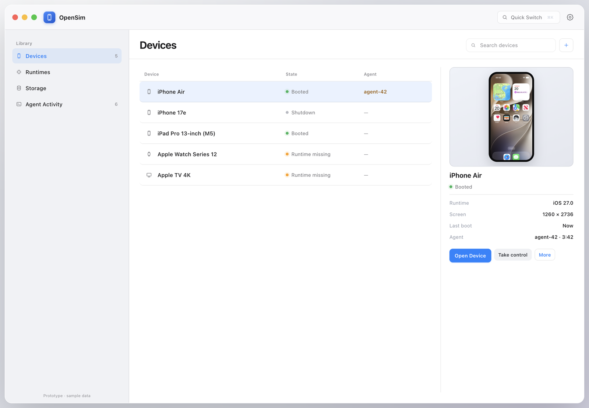
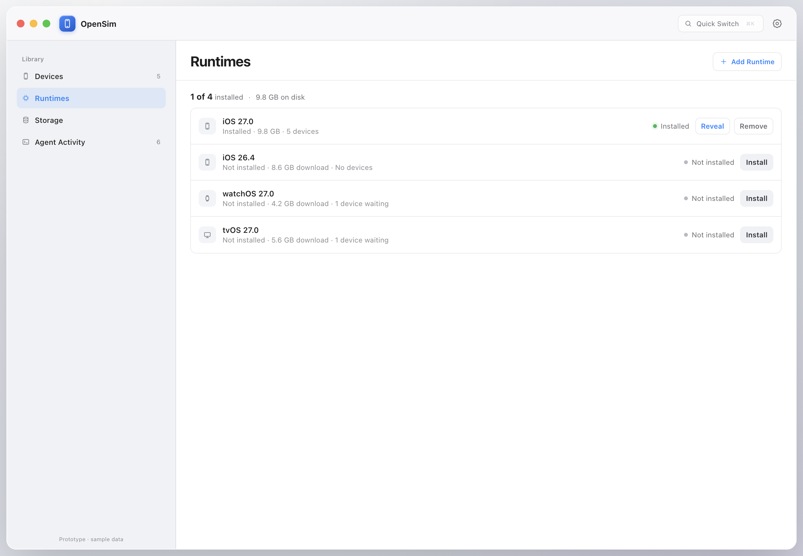
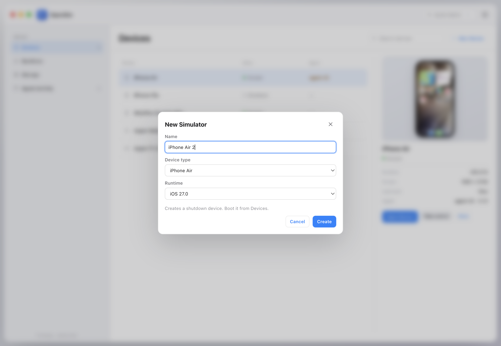
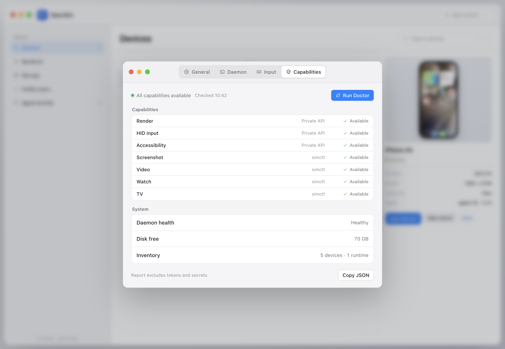

# OpenSim

### The missing Simulator.app for Xcode 27 — built for agents and humans.

OpenSim is an open-source control plane for Apple Simulator. It is designed so an AI agent can see the screen, tap, type, read the accessibility tree, and manage devices — while you watch the same session in a native macOS window and take over with one click.

[](#status)
[](LICENSE)
[](#requirements)
[](#requirements)
[](#architecture)



<p align="center"><sub>UI prototype with sample data. The native app is not built yet.</sub></p>

> **Status — design phase.** The [design spec](docs/superpowers/specs/2026-10-19-open-simulator-design.md) and ten implementation plans are complete. There is no runnable build yet. **Star or watch the repo to follow the first build in Plan 1.**

## Why now

Xcode 27 removed `Simulator.app` and replaced it with Device Hub. `simctl` still boots devices, installs apps, captures screenshots, records video, and streams logs — but it has no tap, swipe, type, or accessibility-tree commands.

Agents can start a simulator. They cannot reliably use it.

OpenSim does not reimplement the emulator. It drives Apple's simulator runtimes and adds the missing control layer: input, a semantic UI tree, leases, audit, runtime management, and a real macOS window for humans.

## What OpenSim will do

- **See** — live simulator screen in a native macOS window.
- **Drive** — tap, swipe, long-press, drag, pinch, rotate, type, keyboard, hardware buttons.
- **Inspect** — semantic accessibility tree, selectors, screenshots, video, logs.
- **Coordinate** — control/observe leases, takeover after a grace period, full audit trail.
- **Manage** — device lifecycle, multiple runtime versions, `.dmg` runtime import, disk cleanup, CPU/RAM metrics.
- **Choose a client** — one engine behind the `opensim` CLI, an MCP server, and the macOS app.

## How it works

1. **Connect** — an agent talks to the local daemon over MCP or the CLI.
2. **Lease** — the agent takes a `control` lease on one simulator; other clients can still observe.
3. **Control** — input and reads go through OpenSim's bridge. A human can take over at any time; every write is audited.

```text
Agent / CLI / MCP ── OpenSim daemon ── OpenSim bridge ── Apple Simulator
                           │
                    native macOS app (same session, human takeover)
```

The daemon binds to loopback only. It stays local; there is no cloud dependency.

## Screens

<table>
  <tr>
    <td width="33%"><br><sub><b>Runtimes</b> — multiple versions, Add Runtime</sub></td>
    <td width="33%"><br><sub><b>New Simulator</b> — name, type, runtime</sub></td>
    <td width="33%"><br><sub><b>Doctor</b> — render, HID, accessibility, video</sub></td>
  </tr>
</table>

These are HTML prototypes, not screenshots of the finished app. More states: [Settings](proto/ui/shot-settings-general.png), [Runtimes in use](proto/ui/shot-runtime-in-use.png), [Agent Activity](proto/ui/shot-activity-v2-final.png).

## Why not just use…?

| Tool | What it is good at | Where OpenSim differs |
|---|---|---|
| `simctl` / Device Hub | Lifecycle, install, screenshots, video, logs | OpenSim adds touch, typing, accessibility, leases, MCP, and a live UI |
| [idb](https://github.com/facebook/idb) | Mature automation primitives for simulators and devices | OpenSim targets one local control plane with MCP, a native app, leases, and audit |
| [Appium](https://github.com/appium/appium) / [Maestro](https://github.com/mobile-dev-inc/maestro) | Cross-platform end-to-end test frameworks | OpenSim is not a test runner; it is the simulator control layer beneath one |
| [XcodeBuildMCP](https://github.com/getsentry/MobileBuildMCP) | MCP/CLI for building and testing Xcode projects | OpenSim focuses on live simulator control, runtime management, and human takeover |
| Device Hub | A human GUI for devices | OpenSim exposes the same capability to humans, CLI, and agents |

## Roadmap

```text
0  Private-API spike          ← next
1  Core + bridge + CLI
2  Screen + input + accessibility
3  Daemon + sessions + MCP
4  Native macOS app
5  Storage + performance
6  watchOS + tvOS
7  Hardening + release
8  visionOS
9  Physical devices
```

The first usable build is Plan 1: `opensim doctor`, device lifecycle, runtime/app/log commands. Plans 0–9 and their acceptance criteria live in [docs/superpowers/plans](docs/superpowers/plans).

## Documentation

- [Design spec](docs/superpowers/specs/2026-10-19-open-simulator-design.md)
- [Plan map and shared interfaces](docs/superpowers/plans/2026-10-20-plan-map-and-interfaces.md)
- [Implementation plans 0–9](docs/superpowers/plans)
- [UI audit](docs/superpowers/specs/2026-10-20-opensim-ui-audit.md)
- [UI prototype](proto/ui/devices-v2.html)

## Requirements

- macOS 27.0 or later, arm64.
- Full Xcode 27.1 or later. Command Line Tools alone are not enough.
- An installed iOS simulator runtime for the core workflow; watchOS/tvOS runtimes for those platforms.

## Security and Apple private APIs

OpenSim runs locally. The daemon binds to loopback, uses a random bearer token stored with `0600` permissions, and keeps a local audit log. No telemetry, screenshots, or logs are uploaded anywhere.

Live rendering, HID input, and accessibility rely on Apple private frameworks. OpenSim is therefore not suitable for the Mac App Store and must track Xcode changes. `opensim doctor` reports what works on the current machine; unsupported capabilities are disabled instead of crashing the app.

## Contributing

The design is deliberately written down before implementation. The most useful contribution right now is design review:

- Read the [spec](docs/superpowers/specs/2026-10-19-open-simulator-design.md) and the [plan map](docs/superpowers/plans/2026-10-20-plan-map-and-interfaces.md).
- Open an issue for a broken assumption, a missing platform behavior, or a clearer API.
- If you want to implement a plan, say which one; keep private APIs inside `OpenSimBridge` and CLI/MCP behind the shared operation catalog.

If you want an agent-operable Simulator, **star the repo**. It is the clearest signal that Plan 1 should ship next.

## License

MIT. See [LICENSE](LICENSE).
